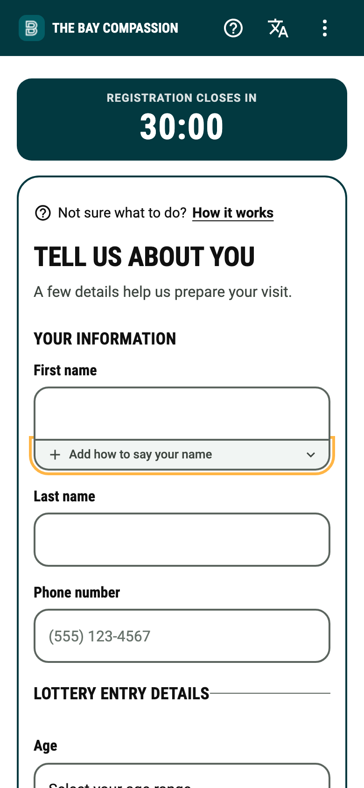
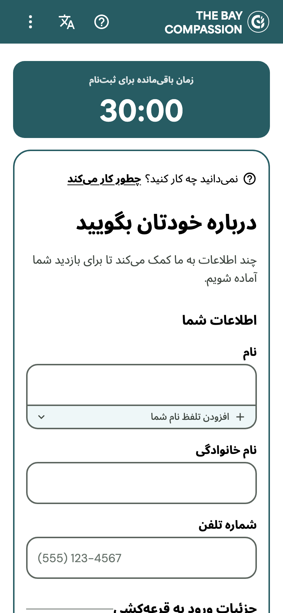
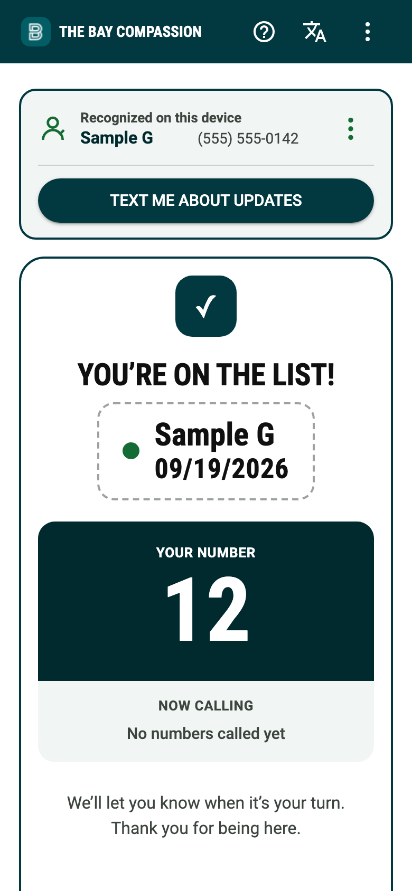
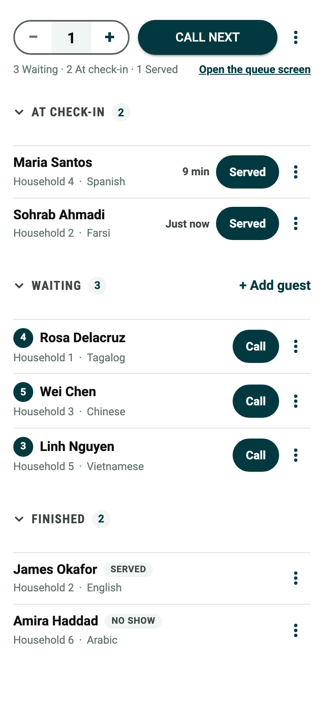

# The Bay Compassion

At The Bay Compassion's community food market, guests shop for groceries they choose themselves.
We want the process of getting a shopping place to offer more dignity, too.
This app is being built to give guests time to register and the market more control over how it
allocates limited places and understands unmet demand.

**[Read the Case Study](https://bay-compassion.github.io/food-market-app/)** ·
**[Guest Walkthrough](https://bay-compassion.github.io/food-market-app/presentations/guest-guide/)** ·
**[Volunteer Walkthrough](https://bay-compassion.github.io/food-market-app/presentations/queue-desk/)**

## Why the Market Wanted a Change

Guests shop much as they would in a grocery store, choosing food that meets their needs rather
than receiving a predetermined bag. That choice is part of
[Compassion Food's commitment to dignity and belonging](https://www.thebaycompassion.org/programs/compassion-food).
But getting a place had become a race: by 10:31 on Saturday morning, registration was full.
Some guests entered only initials to submit faster. Seniors, people less comfortable with
technology, and people reading in a non-native language could lose places while taking the time
they needed to register.

The new process gives guests a fifteen-minute window before selection. They can read and enter
information with less urgency. Registering from home can also spare someone a trip when they are
not selected. The guest interface supports eight languages, including right-to-left layouts for
Arabic and Farsi.

A purpose-built app also lets the market develop its allocation approach over time, with
adjustable lottery weights and manual promotion. The policy for using those capabilities is still
being defined; the app does not remove the limit on how many guests can shop.

## Reaching the People Who Live Here

Language support was chosen with the regional population in mind. English, Spanish, Tagalog,
Chinese, Farsi, Arabic, Vietnamese, and French cover the guest journey, from registration through
lottery results and check-in instructions. Guests recognize language choices by their own names;
Arabic and Farsi also change the layout to follow a right-to-left reading direction.

Accessibility belongs to that same work. The interface includes labeled fields, prominent queue
numbers, visible keyboard focus, screen-reader status announcements, and reduced-motion support
on the queue number board. Giving people more time to register matters only if they can
understand and use the process.

## Understanding the People Who Cannot Get a Place

The existing system closes registration when capacity is reached, so the market cannot see how
many more people wanted to register. Keeping registration open for the full window can reveal
more demand beyond the places available. Demographic and market questionnaires also help gather
aggregate information we can use in grant writing and explaining the mission.
These are intended benefits, not measured outcomes of the new app.

Read [Shopping for Food Shouldn’t Start with a Race](docs/project-purpose.md) for the market’s
account of why we are building the app.

<table>
  <tr>
    <td width="50%"></td>
    <td width="50%"></td>
  </tr>
  <tr><td>Register on a phone.</td><td>Choose your language.</td></tr>
  <tr>
    <td width="50%"></td>
    <td width="50%"></td>
  </tr>
  <tr><td>Follow your place in line.</td><td>Keep the service moving.</td></tr>
</table>

Screenshots use fictional data and are generated from the current app and Storybook. Refresh them
with `npm run capture:portfolio`; see the [portfolio publishing guide](docs/portfolio.md).

## Caring for Guest Information

The app collects personal details to run the market, so privacy is part of its design. Server-side
permissions separate the current queue, aggregate reports, and identifying exports. Guest device
and visit credentials are stored as hashes on the server; handled API responses use `no-store`.
Operational logs remove sensitive fields, and replay settings mask inputs and marked identity
information. Text updates require explicit consent.

See [Privacy and Security in the Design](docs/privacy-design.md) for the implementation examples,
existing verification, and configuration considerations behind those controls.

## My Role and Process

The vision came from the market team. I was the sole technical contributor, responsible for
architecture, product management, requirements gathering, and implementation. I interviewed stakeholders and observed the market’s existing practices to understand how the service worked. That research informed the requirements
and how the app would behave for guests and the market team.

## Engineering Decisions

The frontend uses **React, TypeScript, MobX, and Emotion**. **Netlify Functions, Postgres, and
Drizzle** provide the API and persistent state. **Auth0** protects staff operations; notification
delivery uses **Web Push, Twilio, and Netlify Async Workloads**.

- **Share domain rules across browser and server.** Plain TypeScript models and explicit state
  machines define session and visit behavior. React reads observable stores rather than recreating
  those rules in each screen. See the [session lifecycle](docs/session-lifecycle.md) and
  [data model](docs/data-model.md).
- **Treat localization as behavior.** Typed translation dictionaries cover guest copy, while the
  selected language also controls writing direction. See [the translation source](src/locales.ts).
- **Make review artifacts follow the implementation.** Storybook exposes component states; the
  printable review document embeds those stories and captures states that require interaction.
  The guest presentation runs the actual guest app inside its phone. See the
  [review workflow](docs/screenshots.md) and [presentation implementation](packages/presentations/README.md).
- **Verify at several levels.** Unit tests exercise domain and API behavior, Storybook tests render
  components and interactions, and Playwright covers guest journeys and the full-stack queue rig.
  See [browser test coverage](e2e/README.md) and [server security](docs/server-security.md).

## Try It Without Setup

The [project site](https://bay-compassion.github.io/food-market-app/) includes three interactive
presentations using fictional guests. No account or backend setup is needed.

- [Market Day Reel](https://bay-compassion.github.io/food-market-app/presentations/market-day-reel/):
  a one-minute visual overview.
- [Guest Market Guide](https://bay-compassion.github.io/food-market-app/presentations/guest-guide/):
  registration, lottery results, queue updates, and check-in. The phone supports all eight languages;
  narration is in English.
- [Queue Desk Guide](https://bay-compassion.github.io/food-market-app/presentations/queue-desk/):
  calling guests, managing arrivals, and closing a session.

## Run Locally

Use Node.js 24 (see [.nvmrc](.nvmrc)):

```bash
npm install
VITE_LAUNCHDARKLY_DISABLED=true npm run dev
```

This starts the frontend. API-backed workflows need the Netlify runtime and local configuration;
see [development and operations](docs/development.md) for `npm start`, fake data, Auth0, deployment,
and notification setup.

To explore components and their states independently:

```bash
npx playwright install chromium # once, for browser tests and captures
npm run storybook              # component workshop on port 6006
```

## Verify Changes

```bash
npm run checks                 # lint, formatting, diagrams, unit tests, build
npm run test:storybook         # component rendering and interactions
npm run test:e2e               # guest browser journeys
```

The [contributor guide](AGENTS.md) covers mobile-first design, localization, state management, and
verification requirements. [The concepts guide](docs/concepts.md) explains the system for
maintainers without a software background.

## Find Your Way Around

| Area                      | Contents                                                             |
| ------------------------- | -------------------------------------------------------------------- |
| `src/`                    | React screens, observable stores, shared domain models, and services |
| `netlify/`                | API handlers, server services, and database migrations               |
| `db/`                     | Drizzle schema and database client                                   |
| `.storybook/`             | Component workshop and printable review document                     |
| `scripts/screenshots/`    | Deterministic review and portfolio captures                          |
| `packages/presentations/` | Portfolio site, narrated guides, and video exports                   |
| `docs/`                   | Architecture, security, development, and operations guides           |

Database migrations apply during Netlify builds. Read [the migration guide](docs/migrations.md)
before changing them.
