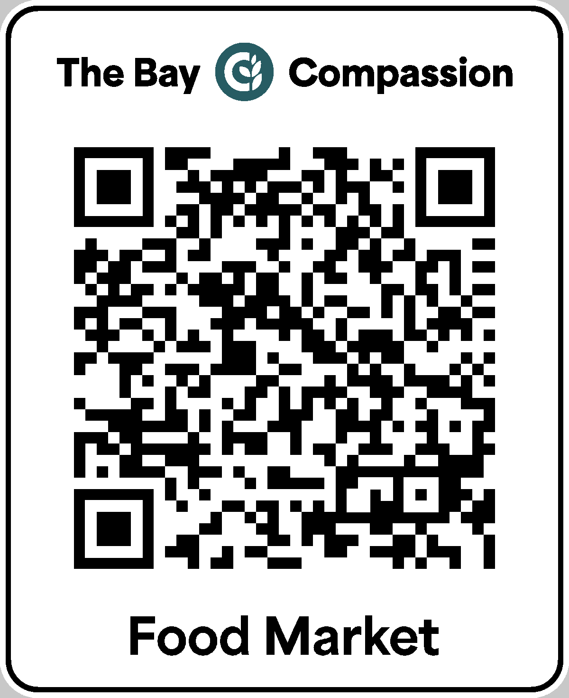

# Check-In Desk Placard

A 3D-printed sign for the check-in desk. Its QR code opens
`https://go.thebaycompassion.org/food-market/placard`, so a guest who closes the app by accident
can scan it and get back to the market page. The URL is printed into plastic: keep that short link
resolving for as long as these signs are in use.



| File                  | What It Is                                                              |
| --------------------- | ----------------------------------------------------------------------- |
| `placard.3mf`         | Bambu Studio project for the sign, with filaments and plate already set |
| `placard-foot.stl`    | Stand that holds the sign leaning back; print two                       |
| `placard-preview.png` | The printed face, rendered from the model                               |
| `build.py`            | Regenerates all three from the logo, the font, and the URL              |

## Printing

Built for a Bambu Lab A1 (0.4 mm nozzle) with an AMS Lite, on the textured PEI plate the printer
ships with. Open `placard.3mf` and map the three filament slots to your spools:

| Slot | Filament                              | Parts                            |
| ---- | ------------------------------------- | -------------------------------- |
| 1    | Bambu PLA Basic, white                | The sign's body                  |
| 2    | Bambu PLA Basic, black                | QR code, wordmark, title, border |
| 3    | Bambu PLA Metal, Oxide Green Metallic | Logo icon                        |

Bambu sells no teal, and Oxide Green Metallic is the closest of its filaments to the brand's
`#275C63`. Map slot 3 to black to print the sign in two colors.

The sign prints face-down: the artwork is set 0.6 mm into the face, so filament changes happen only
in the first three layers and the plate gives the face its finish. The textured plate's matte
finish is deliberate, since a glossy face can throw glare that stops a phone reading the code.
Expect about an hour and a half and 45 g of filament. Print `placard-foot.stl` twice as a separate
job.

## Rebuilding

```bash
uv run signage/check-in-placard/build.py
```

The script declares its own Python dependencies, so `uv` is the only prerequisite besides Bambu
Studio, whose command-line slicer writes the project file (set `BAMBU_STUDIO` if it isn't in
`/Applications`). The artwork comes from `public/bay-compassion-primary.svg` and the title is set
in Area Normal Extrabold from `public/fonts/`. The script fails if the QR code doesn't decode to
the URL from the rendered face, or if any artwork crowds the code's quiet zone, the blank margin
of four modules a scanner needs.
